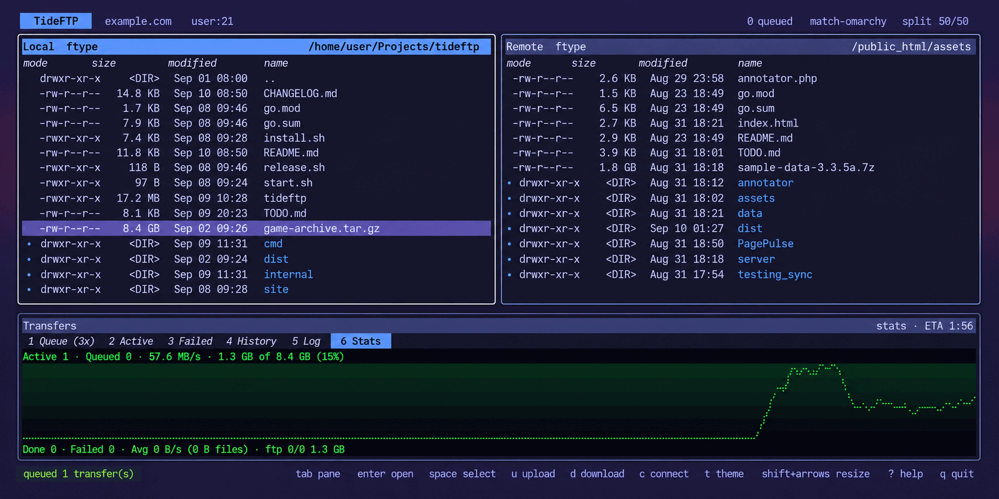

# TideFTP

TideFTP is a keyboard-first, mouse-friendly terminal client for SFTP, FTP,
and FTPS. It has the familiar two-pane layout, a real transfer queue, directory
mirroring, previews, editing, and a scriptable command line. It does file
transfers. It does not contain a chat window, a blockchain, or a weather
widget.



## Install

```bash
curl -fsSL https://raw.githubusercontent.com/allisonhere/TideFTP/main/install.sh | sh
```

The installer puts `tideftp` in `~/.local/bin` by default. Set `INSTALL_DIR`
to use another directory. You can also download an archive from the
[latest release](https://github.com/allisonhere/TideFTP/releases/latest).

TideFTP supports Linux and macOS. Windows remains on the other side of the
river for now.

## Connect

Run `tideftp`, press `c`, and add a server. The left pane is your machine. The
right pane is the server. Press `Tab` to switch between them, `u` to upload,
and `d` to download.

You can also connect at startup:

```bash
# SFTP, the default
tideftp --host files.example.com --user allie --path /srv/www

# Explicit FTPS on port 21
TIDEFTP_FTP_PASSWORD=... tideftp --protocol ftps \
  --host files.example.com --user allie --path /pub

# Implicit FTPS on port 990
TIDEFTP_FTP_PASSWORD=... tideftp --protocol ftps-implicit \
  --host files.example.com --user allie --path /pub
```

SFTP uses your SSH agent and normal SSH keys. Host keys are checked against
`~/.ssh/known_hosts`. FTPS verifies server certificates. Passwords come from
the operating system keyring, `TIDEFTP_SFTP_PASSWORD`,
`TIDEFTP_FTP_PASSWORD`, or `--password-stdin`. They are never accepted as a
flag because `ps` is a terrible password manager.

The [wiki](https://github.com/allisonhere/TideFTP/wiki) covers saved profiles,
private FTPS certificates, host-key policies, configuration, and the
differences between the two FTPS modes.

## What it does

- Queues files with parallel transfers, speed, progress, and estimated time.
- Uploads and downloads directories after a cancellable preflight scan.
- Reconnects after a dropped connection and reviews interrupted transfers for
  safe resume or restart.
- Mirrors one pane into the other. Deleting extra destination files is always
  opt-in.
- Previews text and binary files without downloading the whole file.
- Opens images, edits text files in your editor, and writes changed remote
  files back.
- Filters, sorts, bookmarks, renames, deletes, and changes permissions.
- Supports themes, mouse input, pane resizing, and an ASCII fallback.
- Runs as a command-line client for shell scripts, cron, and CI.

## Keys worth remembering

| Key | Action |
|---|---|
| `Tab` | Switch between local and remote panes |
| `Enter`, `Backspace` | Open a directory or its parent |
| `Space` | Select an item |
| `u`, `d` | Upload or download |
| `M` | Plan a directory mirror |
| `v`, `e` | Preview or edit a file |
| `/`, `s`, `S` | Filter, sort, or reverse the sort |
| `b`, `B` | Open bookmarks or toggle one |
| `Delete` | Delete selected items after confirmation |
| `1` through `5` | Open Queue, Failed, History, Log, or Stats |
| `R`, `x` | Retry a failed transfer or cancel active work |
| `c` | Open the connection picker |
| `Ctrl+K` | Open the command palette |
| `,`, `t`, `?` | Open Settings, themes, or help |
| `q` | Quit, assuming you are emotionally prepared |

The [interface guide](https://github.com/allisonhere/TideFTP/wiki/Using-the-interface)
has the complete key reference. Transfer safety and recovery live in the
[transfer guide](https://github.com/allisonhere/TideFTP/wiki/Transfers-and-recovery).

## Use it in scripts

The same binary works without the interface:

```bash
tideftp ls --profile prod /var/www
tideftp get --profile prod /var/log/app.log ./logs/
tideftp put --profile prod ./build.tar /releases/
tideftp sync --dry-run --delete ./site prod:/var/www
tideftp script --profile prod deploy.tide
tideftp shell --profile prod
```

Commands include `ls`, `stat`, `exists`, `get`, `put`, `pget`, `rm`, `mkdir`,
`mv`, `cat`, `du`, `find`, `tree`, `chmod`, `ln`, `readlink`, `sync`, and
`mirror`. `ls`, `stat`, and `find` can print JSON. Exit codes distinguish an
operation failure, bad arguments, a connection failure, rejected credentials,
and a missing path.

Existing destinations are not overwritten without permission. Uploads use a
temporary `.part` file and rename it after success. `sync --delete` deletes
only after every copy succeeds and refuses an empty source by default. This is
less exciting than accidental data loss, which is the point.

Read the [command-line guide](https://github.com/allisonhere/TideFTP/wiki/Command-line-and-scripting)
for the practical overview or [docs/scripting.md](docs/scripting.md) for the
full reference and recipes.

## Updates

Release builds check GitHub once at startup. When a release is available,
press `U` to install it. TideFTP downloads the archive from GitHub, verifies it
against the release's `SHA256SUMS`, and then replaces the binary. Development
builds do not check because `dev` is not a useful version to compare.

Disable the check in Settings or in `config.toml`:

```toml
[updates]
check_on_startup = false
```

## Support

TideFTP is free and built and maintained by one person. If it saves you time,
you can [sponsor it on GitHub](https://github.com/sponsors/allisonhere),
one-time or monthly. Starring the repo and reporting bugs in
[issues](https://github.com/allisonhere/TideFTP/issues) help too.

## Develop

```bash
go run ./cmd/tideftp
go test ./...
go test -race ./...
go vet ./...
```

The default tests are hermetic. `tideftp --transfer-lab` exercises queue and
recovery behavior without contacting a real server or writing real transfer
data.

See the [development wiki page](https://github.com/allisonhere/TideFTP/wiki/Development)
for build, test, and release notes. The roadmap lives in [TODO.md](TODO.md),
and release history lives in [CHANGELOG.md](CHANGELOG.md).


